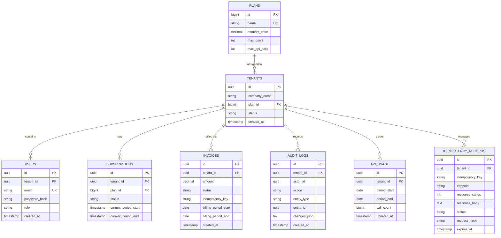

# Enterprise B2B SaaS Billing & Invoicing Engine

[](https://adoptium.net/)
[](https://spring.io/projects/spring-boot)
[](https://www.postgresql.org/)
[](https://flywaydb.org/)
[](https://spring.io/projects/spring-security)
[](LICENSE)

A multi-tenant subscription billing and invoicing backend built with **Java 21 LTS**, **Spring Boot 3.3.4**, and **PostgreSQL 16**.

The project explores backend engineering challenges in subscription management, prorated billing calculations, tenant data isolation, concurrency control, idempotent request processing, and standardized REST API error handling.

Key implementation areas include:
- **Multi-Tenant Isolation:** Organization-scoped data access, JWT authentication with role-based authorization (`ROLE_ADMIN`, `ROLE_MEMBER`), and global user identity constraints.
- **Subscription Billing:** Plan tier transitions, day-based proration calculations, invoice generation, and calendar-month period lifecycle management.
- **Concurrency Control:** Database-level pessimistic locking (`SELECT ... FOR UPDATE`) to protect selected subscription, seat allocation, and invoice payment operations.
- **Idempotency:** SHA-256 request payload fingerprinting and cached replay handling to help prevent duplicate processing.
- **Database Management:** Versioned Flyway migrations (V1–V5), relational constraints (`ON DELETE RESTRICT`), and tenant-oriented compound indexes.
- **Automated Testing:** JUnit 5, Spring Boot integration tests, multi-threaded concurrency tests, Testcontainers with PostgreSQL 16, and GitHub Actions CI.

> **Portfolio Project Context:** This project is a portfolio implementation of production-oriented backend patterns. It does not currently integrate with an external payment gateway (such as Stripe or Adyen), and its performance and operational characteristics should not be interpreted as validated for high-throughput production scale.

---

## Table of Contents

- [Core Engineering Challenges Addressed](#core-engineering-challenges-addressed)
- [System Architecture](#system-architecture)
- [Multi-Tenancy & Security Model](#multi-tenancy--security-model)
- [Financial Calculation & Proration Engine](#financial-calculation--proration-engine)
- [Concurrency & Pessimistic Locking](#concurrency--pessimistic-locking)
- [Idempotency Pipeline](#idempotency-pipeline)
- [Database Schema & Data Model](#database-schema--data-model)
- [REST API Reference](#rest-api-reference)
- [Error Handling (Problem Details)](#error-handling-problem-details)
- [Project Roadmap & Implementation Units](#project-roadmap--implementation-units)
- [Known Limitations & Design Trade-Offs](#known-limitations--design-trade-offs)
- [Getting Started & Local Setup](#getting-started--local-setup)
- [Automated Verification & Test Strategy](#automated-verification--test-strategy)

---

## Core Engineering Challenges Addressed

1. **Multi-Tenant Data Isolation:** Enforces organization-scoped data access using discriminator scoping (`tenant_id`), global user uniqueness, and request-scoped `TenantContext` ThreadLocals with guaranteed cleanup.
2. **Decimal-Based Financial Calculations:** Avoids IEEE 754 binary floating-point inaccuracies (`float`/`double`). Monetary calculations and usage percentages use Java `BigDecimal` with explicit scale and `RoundingMode.HALF_UP` rounding.
3. **Mid-Cycle Subscription Upgrades & Prorations:** Computes day-based fractional credit for unused time on active subscriptions and calculates the net difference for tier changes.
4. **Pessimistic Row-Level Concurrency Control:** Uses pessimistic locking (`SELECT ... FOR UPDATE`) to serialize selected concurrent operations (such as seat invitations, subscription tier mutations, and invoice payments).
5. **Downgrade Quota Guardrails:** Blocks subscription downgrades when current active tenant assets (such as invited team seats) exceed the target tier's capacity.
6. **Audit Logging & Invoicing Records:** Maintains append-only audit logs capturing actor, action, timestamp, and JSON state diffs, paired with database foreign key protections (`ON DELETE RESTRICT`) to prevent accidental cascade deletion of financial and audit history.

---

## System Architecture

```
                    [ API Consumer / Frontend Client ]
                                   │
                                   │ HTTP + Bearer JWT + X-Idempotency-Key
                                   ▼
      ┌─────────────────────────────────────────────────────────────┐
      │               Spring Boot 3 Web Application                 │
      │                                                             │
      │  ┌───────────────────────────────────────────────────────┐  │
      │  │             Security & Filter Pipeline                │  │
      │  │  1. CorrelationIdFilter (Tracing & MDC)               │  │
      │  │  2. JwtAuthenticationFilter (Token Parsing & Auth)    │  │
      │  │  3. TenantContext (ThreadLocal tenantId population)   │  │
      │  │     * Guaranteed `finally` cleanup prevents leakage   │  │
      │  │  4. IdempotencyFilter (SHA-256 fingerprint & replay)  │  │
      │  └──────────────────────────┬────────────────────────────┘  │
      │                             ▼                               │
      │  ┌───────────────────────────────────────────────────────┐  │
      │  │                  REST Controllers                     │  │
      │  │  - AuthController            - PlanController         │  │
      │  │  - TenantController          - UserController         │  │
      │  │  - SubscriptionController    - InvoiceController      │  │
      │  │  - UsageController                                    │  │
      │  └──────────────────────────┬────────────────────────────┘  │
      │                             ▼                               │
      │  ┌───────────────────────────────────────────────────────┐  │
      │  │                    Service Layer                      │  │
      │  │  - ProrationService (Deterministic Math)              │  │
      │  │  - SubscriptionService (Pessimistic Locks & Quotas)   │  │
      │  │  - UserService (Seat Capacity Enforcement)            │  │
      │  │  - InvoiceService (Locking & State Transitions)       │  │
      │  │  - UsageMeteringService (Atomic SQL Usage Tracking)   │  │
      │  │  - AuditService (Event Logging)                       │  │
      │  └──────────────────────────┬────────────────────────────┘  │
      │                             ▼                               │
      │  ┌───────────────────────────────────────────────────────┐  │
      │  │         Repository Layer (Spring Data JPA)            │  │
      │  │  - Row-Level Locking (@Lock(PESSIMISTIC_WRITE))       │  │
      │  │  - Tenant-Scoped Queries & Compound Indexes           │  │
      │  └──────────────────────────┬────────────────────────────┘  │
      └─────────────────────────────┼───────────────────────────────┘
                                    │
                                    ▼
                     [ PostgreSQL 16 Relational DB ]
                     - Multi-Tenant Discriminator Column (tenant_id)
                     - Versioned Flyway Migrations (V1–V5)
                     - Scoped Compound B-Tree Indexes & Foreign Keys
```

---

## Multi-Tenancy & Security Model

The system implements a **Shared Database, Shared Schema (Discriminator Column)** multi-tenant architecture, structuring data isolation around a tenant identifier column (`tenant_id`).

### 1. Request Lifecycle & Context Isolation
1. Clients provide a signed JWT bearer token in the `Authorization: Bearer <token>` header.
2. `JwtAuthenticationFilter` validates the HMAC-SHA256 signature, extracts the `tenantId`, `sub` (email), and `role` claims, and seeds the Spring `SecurityContextHolder`.
3. The tenant identifier is stored in `TenantContext.setTenantId(tenantId)`:
   ```java
   public final class TenantContext {
       private static final ThreadLocal<UUID> CURRENT_TENANT = new ThreadLocal<>();
       public static void setTenantId(UUID tenantId) { CURRENT_TENANT.set(tenantId); }
       public static UUID getTenantId() { return CURRENT_TENANT.get(); }
       public static void clear() { CURRENT_TENANT.remove(); }
   }
   ```
4. **Guaranteed Context Cleanup:** The filter wraps execution in a top-level `try ... finally` block, ensuring `TenantContext.clear()` executes on all requests (including unauthenticated, expired, or error paths) to prevent `ThreadLocal` value leakage across pooled worker threads.

### 2. Dual-Verification Query Filtering
Domain queries verify tenant ownership explicitly (e.g., `findByIdAndTenantId`). Cross-tenant access attempts return `404 Not Found` rather than `403 Forbidden` to prevent enumeration of resource IDs belonging to other organizations.

### 3. Global Identity & Authentication Alignment
User emails are globally unique across all tenants (`uq_users_email`), aligning database constraints with the single-identifier login flow (`AuthService.login(email, password)`) and preventing cross-tenant authentication collisions.

---

## Financial Calculation & Proration Engine

Subscription tier upgrades mid-cycle are computed by [`ProrationService`](src/main/java/com/enterprise/billing/service/ProrationService.java) using day-based fractional mathematics:

$$\text{Total Days} = \max(1, \text{Days between Period Start and Period End})$$
$$\text{Days Remaining} = \max(0, \text{Days between Calculation Date and Period End})$$
$$\text{Unused Fraction} = \frac{\text{Days Remaining}}{\text{Total Days}}$$
$$\text{Prorated Credit} = \text{Old Plan Price} \times \text{Unused Fraction}$$
$$\text{New Plan Charge} = \text{New Plan Price} \times \text{Unused Fraction}$$
$$\text{Net Amount Due} = \max(0.00, \text{New Plan Charge} - \text{Prorated Credit})$$

- **Explicit Decimal Scaling:** Monetary calculations use `BigDecimal` with intermediate scale of 10 and final rounding scaled to 2 decimal places using `RoundingMode.HALF_UP`.
- **Zero Floating-Point Types:** Binary floating-point primitives (`float` and `double`) are avoided across financial calculations and DTOs.
- **Expired Cycle Handling:** If an upgrade occurs on a subscription whose `currentPeriodEnd` has already passed, the engine resets the billing cycle forward by one calendar month (`plusMonths(1)`) and charges the full target plan price.

---

## Concurrency & Pessimistic Locking

To reduce race conditions during simultaneous checkout or plan mutation requests, the system utilizes database-level row locks:

### 1. Subscription Mutation Locking
[`SubscriptionRepository`](src/main/java/com/enterprise/billing/repository/SubscriptionRepository.java) applies a pessimistic write lock before evaluating plan transitions:

```java
@Lock(LockModeType.PESSIMISTIC_WRITE)
@Query("SELECT s FROM Subscription s WHERE s.tenant.id = :tenantId")
Optional<Subscription> findByTenantIdWithLock(@Param("tenantId") UUID tenantId);
```

When multiple upgrade requests arrive simultaneously for the same tenant:
1. Thread 1 acquires the exclusive row lock (`SELECT ... FOR UPDATE`).
2. Threads 2, 3, and 4 block until Thread 1 commits.
3. Upon acquiring the lock, subsequent threads detect that the subscription has already transitioned and safely terminate with a validation error or replayed response, reducing duplicate processing and conflicting state transitions.

### 2. Seat Capacity Quota Locking
[`TenantRepository`](src/main/java/com/enterprise/billing/repository/TenantRepository.java) locks the tenant row (`findByIdWithLock`) during team invitations in `UserService.createUser`. This serializes seat allocation checks under high contention, ensuring total active members do not exceed the plan's `max_users` quota.

### 3. Invoice Payment Locking
[`InvoiceRepository`](src/main/java/com/enterprise/billing/repository/InvoiceRepository.java) acquires a pessimistic write lock (`findByIdAndTenantIdWithLock`) during payment settlement, ensuring that concurrent payment attempts process exactly once.

---

## Idempotency Pipeline

Mutating operations support idempotent execution via the `X-Idempotency-Key` header through [`IdempotencyFilter`](src/main/java/com/enterprise/billing/config/IdempotencyFilter.java):

```
Incoming Request (POST / PUT / PATCH)
  │
  ├── 1. Compute SHA-256 fingerprint: hash(HTTP Method + Request URI + Raw Body)
  │
  ├── 2. Query idempotency_records(tenant_id, idempotency_key)
  │     ├── If COMPLETED and hash matches -> Replay cached response (status + body)
  │     ├── If COMPLETED and hash differs  -> 409 Conflict (ERR_IDEMPOTENCY_CONFLICT)
  │     └── If PROCESSING                 -> 409 Conflict (ERR_IDEMPOTENCY_IN_PROGRESS)
  │
  ├── 3. Insert record with status = PROCESSING (catches unique constraint collisions)
  │
  ├── 4. Execute downstream filter chain & controller
  │
  └── 5. On status < 500: Cache response body and mark COMPLETED
        On failure (5xx/exception): Remove in-flight record to allow retry
```

---

## Database Schema & Data Model



### Scoped Compound Indexes & Relational Constraints
Database migrations (`db/migration/V1` through `V5`) define indexes and constraints aligned with multi-tenant query workloads:
- `idx_users_tenant_created` on `users(tenant_id, created_at DESC)`
- `idx_subscriptions_tenant` on `subscriptions(tenant_id)`
- `idx_subscriptions_plan` on `subscriptions(plan_id)` *(added in V4)*
- `idx_invoices_tenant_status` on `invoices(tenant_id, status)`
- `idx_invoices_tenant_created` on `invoices(tenant_id, created_at DESC)`
- `uq_invoices_tenant_idempotency` unique constraint on `invoices(tenant_id, idempotency_key)` *(scoped in V5)*
- `idx_audit_logs_tenant_created` on `audit_logs(tenant_id, created_at DESC)`
- `idx_api_usage_tenant` on `api_usage(tenant_id, period_start, period_end)`
- `idx_idempotency_lookup` on `idempotency_records(tenant_id, idempotency_key)`
- `fk_invoices_tenant` and `fk_audit_logs_tenant` enforce `ON DELETE RESTRICT` *(hardened in V5)*

---

## REST API Reference

### 1. Authentication & Onboarding
| Method | Endpoint | Access | Description |
| :--- | :--- | :--- | :--- |
| `POST` | `/api/auth/register-tenant` | Public | Onboards organization, creates admin user, and provisions an initial calendar-month subscription (`now.plusMonths(1)`). |
| `POST` | `/api/auth/login` | Public | Authenticates user credentials, returns signed HMAC-SHA256 JWT. |

### 2. Plan Catalog & Organization Management
| Method | Endpoint | Access | Description |
| :--- | :--- | :--- | :--- |
| `GET` | `/api/plans` | Public | Lists available subscription plans with monthly pricing and quota tiers. |
| `GET` | `/api/tenants/me` | Authenticated | Retrieves current authenticated organization profile and active plan. |
| `GET` | `/api/users` | Authenticated | Paginated team member list for the authenticated tenant. |
| `POST` | `/api/users` | `ROLE_ADMIN` | Invites a new team member; enforces real-time seat quota. |

### 3. Subscription Management & Proration
| Method | Endpoint | Access | Description |
| :--- | :--- | :--- | :--- |
| `GET` | `/api/subscriptions/me` | Authenticated | Returns active subscription details and days remaining in current billing period. |
| `POST` | `/api/subscriptions/preview-proration` | Authenticated | Calculates exact proration credit, charges, and net due without mutating database state. |
| `POST` | `/api/subscriptions/upgrade` | `ROLE_ADMIN` | Executes atomic upgrade with pessimistic locking, downgrade validation, and invoice generation. |

### 4. Usage Metering & Invoicing
| Method | Endpoint | Access | Description |
| :--- | :--- | :--- | :--- |
| `GET` | `/api/usage/summary` | Authenticated | Retrieves current API usage count, quota limits, and exact `BigDecimal` usage percentage. |
| `GET` | `/api/invoices` | Authenticated | Paginated history of tenant invoices. |
| `GET` | `/api/invoices/{id}` | Authenticated | Fetches invoice by ID with strict tenant isolation. |
| `POST` | `/api/invoices/{id}/pay` | `ROLE_ADMIN` | Transitions invoice status from `PENDING` to `PAID` within the database transaction using row-level pessimistic locking. *(Note: Simulates payment settlement; does not integrate with an external payment gateway).* |

#### Sample Proration Preview Payload
```json
// POST /api/subscriptions/preview-proration
// Request:
{
  "targetPlanName": "PRO"
}

// Response (200 OK):
{
  "oldPlanName": "FREE",
  "newPlanName": "PRO",
  "daysRemaining": 15,
  "totalDays": 30,
  "oldPlanPrice": 0.00,
  "proratedCredit": 0.00,
  "newPlanPrice": 49.00,
  "newPlanCharge": 24.50,
  "netDue": 24.50
}
```

---

## Error Handling (Problem Details)

All error responses follow the Problem Details specification (RFC 7807, updated by RFC 9457) using `Content-Type: application/problem+json`:

```json
{
  "type": "https://api.billing.enterprise.com/errors/quota-exceeded",
  "title": "Resource Quota Exceeded",
  "status": 403,
  "detail": "Plan limit of 5 users reached (current: 5). Upgrade your subscription tier to invite more seats.",
  "instance": "/api/users",
  "timestamp": "2026-10-23T01:14:16.563Z",
  "errorCode": "ERR_QUOTA_EXCEEDED",
  "metadata": {}
}
```

| HTTP Status | Error Code | Description |
| :--- | :--- | :--- |
| `400 Bad Request` | `ERR_VALIDATION_FAILED` | Bean validation constraint violation on request body. |
| `400 Bad Request` | `ERR_INVALID_REQUEST` | Semantic violation (e.g., re-paying an already paid invoice). |
| `401 Unauthorized` | `ERR_UNAUTHORIZED` | Expired, tampered, or missing JWT token. |
| `403 Forbidden` | `ERR_FORBIDDEN` | Caller lacks required role permission (e.g., non-admin upgrade or payment). |
| `403 Forbidden` | `ERR_QUOTA_EXCEEDED` | Seat quota limit exceeded or downgrade blocked due to active users. |
| `404 Not Found` | `ERR_NOT_FOUND` | Resource does not exist or belongs to another tenant. |
| `409 Conflict` | `ERR_DUPLICATE_RESOURCE` | Unique key violation (e.g., duplicate email registration). |
| `409 Conflict` | `ERR_IDEMPOTENCY_CONFLICT` | Idempotency key reused with different request payload. |
| `409 Conflict` | `ERR_IDEMPOTENCY_IN_PROGRESS` | Concurrent in-flight request currently processing for this key. |
| `500 Internal Server` | `ERR_INTERNAL_SERVER` | Unhandled system exception. |

---

## Project Roadmap & Implementation Units

| Unit | Title | Focus & Core Deliverables | Status |
| :--- | :--- | :--- | :--- |
| **Unit 01** | Database Schema & Foundation | Maven configuration, PostgreSQL 16 schema, Flyway migrations (`V1`, `V2`). | ✅ Merged |
| **Unit 02** | JWT Security & Tenant Context | Stateless JWT authentication, `TenantContext` ThreadLocal, RFC 7807 error handlers. | ✅ Merged |
| **Unit 03** | Plans, Registration & IAM | Tenant signup, member invite API, role-based access control, seat quota gating. | ✅ Merged |
| **Unit 04** | Subscription Upgrades & Proration | Exact `BigDecimal` proration engine, pessimistic locking (`FOR UPDATE`), invoices. | ✅ Merged |
| **Unit 05** | Quota Middleware & Invoicing Engine | Usage metering with synchronous PostgreSQL counter increments, itemized invoice state transitions. | ✅ Merged |
| **Unit 06** | Testcontainers Suite & Production Docker | Real PostgreSQL container integration tests, multi-stage production Dockerfile. | ✅ Merged |
| **Unit 07** | IAM & Multi-Tenant Isolation Remediation | Email collision fix, global uniqueness, top-level ThreadLocal cleanup, Flyway V4. | ✅ Merged |
| **Unit 08** | Idempotency Pipeline & Financial Ledgers | IdempotencyFilter, compound key constraint, payload SHA-256 hash, RESTRICT cascade. | ✅ Merged |
| **Unit 09** | Concurrency Control & Real-Time Quotas | Pessimistic locking on seats and invoices, lock-safe idempotency checking, atomic usage SQL. | ✅ Merged |
| **Unit 10** | Billing Precision & Lifecycle Remediation | Eliminated double primitives, expired renewal fix ($0 exploit), calendar-month cycles. | ✅ Merged |
| **Unit 11** | Security Hardening & CI Parity Gate | Invoice pay RBAC, fail-fast JWT secret validator, explicit CORS configuration, CI parity. | ✅ Merged |

---

## Known Limitations & Design Trade-Offs

To maintain architectural transparency, the following design boundaries and intentional trade-offs are disclosed:

1. **No External Payment Gateway Integration:** The `/api/invoices/{id}/pay` endpoint simulates payment settlement by transitioning invoice status to `PAID` within the database transaction. It does not integrate with external payment providers (such as Stripe or Adyen) or process credit cards.
2. **On-Demand Lifecycle vs Recurring Background Scheduler:** Subscription renewal and expired-period detection occur synchronously when an upgrade or invoice operation is requested. The repository does not include an asynchronous recurring background scheduler (e.g., Quartz or Spring `@Scheduled`) to automatically poll and process subscriptions reaching `currentPeriodEnd`.
3. **Synchronous Usage Counting vs Distributed Rate Limiting:** The API usage counter executes an atomic SQL increment against PostgreSQL on each tracked request. While correct for low-to-medium volume, high-throughput production environments typically offload rate limiting to a distributed in-memory cache (such as Redis token buckets).
4. **Mid-Cycle Downgrade Balance Capping:** When a tenant downgrades mid-cycle, unused credit on the higher tier is capped at `netDue = 0.00` to prevent negative invoice amounts. The engine does not currently maintain a persistent credit ledger to apply unused balances toward future billing cycles.

---

## Getting Started & Local Setup

### Prerequisites
- **JDK 21 LTS** (Eclipse Adoptium Temurin recommended)
- **Docker & Docker Compose** (for PostgreSQL)

### 1. Clone & Spin up PostgreSQL
```bash
git clone https://github.com/amy9273/b2b-saas-billing.git
cd b2b-saas-billing

# Start local PostgreSQL 16 container
docker compose up -d
```

### 2. Build & Run Application
```bash
# Windows
.\mvnw.cmd spring-boot:run

# Linux / macOS
./mvnw spring-boot:run
```

The application starts on `http://localhost:8080` and applies Flyway migrations automatically.

---

## Automated Verification & Test Strategy

We adopt a multi-tier testing strategy covering unit, integration, concurrency, and containerized database workflows:

1. **Unit Tests:** Pure mathematical logic, proration calculation, and fail-fast startup validators without external I/O (`ProrationServiceTest`, `UsageMeteringServiceTest`, `JwtSecretValidatorTest`).
2. **Integration Tests (MockMvc & Spring Context):** HTTP request filters, security policies, seat quota enforcement, and database mutations (`OrganizationIamIntegrationTest`, `SubscriptionUpgradeIntegrationTest`, `QuotaAndInvoicingIntegrationTest`, `IdempotencyIntegrationTest`).
3. **Multi-Threaded Concurrency Tests:** Multi-threaded stress tests utilizing `CountDownLatch` and `ExecutorService` to validate row-level locking under concurrent load (`SubscriptionConcurrencyTest`, `QuotaAndPaymentConcurrencyTest`).
4. **PostgreSQL Container Tests:** Schema migration validation and query compatibility via Testcontainers (`PostgresIntegrationTest`).

### Test Execution Commands
```bash
# Run test suite locally
.\mvnw.cmd test

# Run tests with PostgreSQL Testcontainers profile (requires Docker)
.\mvnw.cmd test -Ppostgres-it
```

### Test Suite Execution Summary
- **Local Environment (Docker offline):** 59 tests run — **56 passed, 0 failures, 0 errors, 3 skipped**. (The 3 skipped tests belong to `PostgresIntegrationTest`, configured with `@Testcontainers(disabledWithoutDocker = true)` to avoid build failures on machines without a running Docker engine).
- **GitHub Actions CI (`ubuntu-latest`):** The CI workflow executes `./mvnw clean test -Ppostgres-it --no-transfer-progress` against an active Docker daemon, executing all 59 tests.
