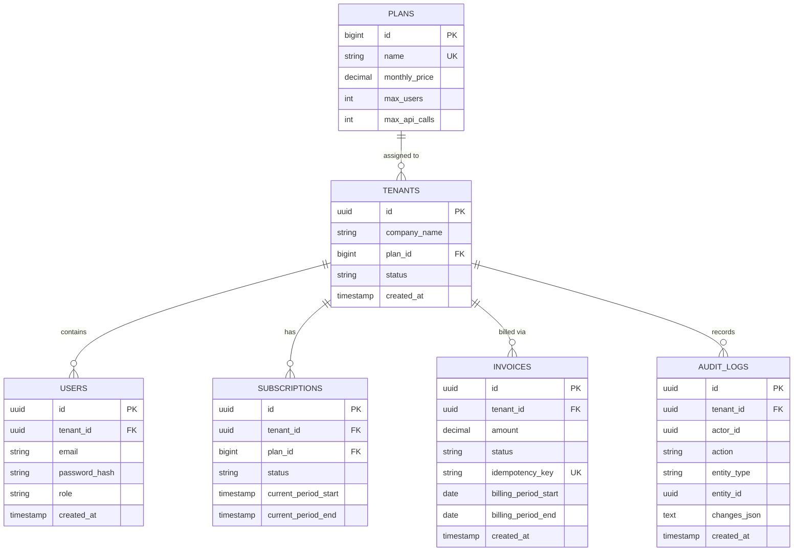

# Enterprise B2B SaaS Billing & Invoicing Engine

[](https://adoptium.net/)
[](https://spring.io/projects/spring-boot)
[](https://www.postgresql.org/)
[](https://flywaydb.org/)
[](https://spring.io/projects/spring-security)
[](LICENSE)

A production-grade, multi-tenant subscription orchestration, proration billing, and resource quota management platform built with **Java 21 LTS**, **Spring Boot 3.3.x**, and **PostgreSQL 16**.

Unlike standard tutorial CRUD apps, this engine tackles mission-critical distributed systems and FinTech challenges: **zero-drift financial mathematics**, **multi-tenant data isolation**, **row-level pessimistic concurrency locking**, **idempotent billing execution**, and **RFC 7807 standardized problem details**.

---

## Table of Contents

- [Core Business Problems Solved](#core-business-problems-solved)
- [System Architecture](#system-architecture)
- [Multi-Tenancy & Security Model](#multi-tenancy--security-model)
- [Financial Calculation & Proration Engine](#financial-calculation--proration-engine)
- [Concurrency & Pessimistic Locking](#concurrency--pessimistic-locking)
- [Database Schema & Data Model](#database-schema--data-model)
- [REST API Reference](#rest-api-reference)
- [Error Handling (RFC 7807)](#error-handling-rfc-7807)
- [Project Roadmap & Implementation Units](#project-roadmap--implementation-units)
- [Getting Started & Local Setup](#getting-started--local-setup)
- [Automated Verification & Test Strategy](#automated-verification--test-strategy)

---

## Core Business Problems Solved

1. **Strict Logical Multi-Tenant Isolation:** Enforces complete data separation across organizations using discriminator scoping (`tenant_id`) and request-scoped `TenantContext` ThreadLocals with guaranteed cleanup.
2. **Deterministic Financial Computation:** Completely avoids IEEE 754 floating-point rounding errors (`float`/`double`). All monetary values, taxes, and prorations utilize exact `BigDecimal(10, 2)` arithmetic with `RoundingMode.HALF_UP`.
3. **Mid-Cycle Subscription Upgrades & Prorations:** Computes exact day-based credit for unused time on existing subscriptions and charges the net prorated difference for higher tiers in real time.
4. **Pessimistic Row-Level Concurrency Control:** Eliminates race conditions during simultaneous checkout or plan mutation requests via database-level `SELECT ... FOR UPDATE` locks.
5. **Downgrade Quota Guardrails:** Rejects plan downgrades if current active tenant assets (such as invited team seats) exceed the target plan's allowance.
6. **Immutable Audit & Invoicing Ledger:** Generates tamper-proof invoice snapshots and append-only audit trail logs capturing actor, action, timestamp, and JSON state diffs for every state mutation.

---

## System Architecture

```
                    [ API Consumer / Frontend Client ]
                                   │
                                   │ HTTP + Bearer JWT + X-Idempotency-Key
                                   ▼
      ┌─────────────────────────────────────────────────────────────┐
      │               Spring Boot 3 Web Application                 │
      │                                                             │
      │  ┌───────────────────────────────────────────────────────┐  │
      │  │             Security & Filter Pipeline                │  │
      │  │  1. CorrelationIdFilter (Tracing & MDC)               │  │
      │  │  2. JwtAuthenticationFilter (Token Parsing & Auth)    │  │
      │  │  3. TenantContext (ThreadLocal tenantId population)   │  │
      │  │     * Guaranteed `finally` cleanup prevents leakage   │  │
      │  └──────────────────────────┬────────────────────────────┘  │
      │                             ▼                               │
      │  ┌───────────────────────────────────────────────────────┐  │
      │  │                  REST Controllers                     │  │
      │  │  - AuthController            - PlanController         │  │
      │  │  - TenantController          - UserController         │  │
      │  │  - SubscriptionController    - InvoiceController      │  │
      │  └──────────────────────────┬────────────────────────────┘  │
      │                             ▼                               │
      │  ┌───────────────────────────────────────────────────────┐  │
      │  │                    Service Layer                      │  │
      │  │  - ProrationService (Deterministic Math)              │  │
      │  │  - SubscriptionService (Pessimistic Locks & Quotas)   │  │
      │  │  - UserService (Seat Capacity Enforcement)            │  │
      │  │  - AuditService (Immutable Event Logging)             │  │
      │  └──────────────────────────┬────────────────────────────┘  │
      │                             ▼                               │
      │  ┌───────────────────────────────────────────────────────┐  │
      │  │         Repository Layer (Spring Data JPA)            │  │
      │  │  - Row-Level Locking (@Lock(PESSIMISTIC_WRITE))       │  │
      │  │  - Tenant Scoped Compound Indexes                     │  │
      │  └──────────────────────────┬────────────────────────────┘  │
      └─────────────────────────────┼───────────────────────────────┘
                                    │
                                    ▼
                     [ PostgreSQL 16 Relational DB ]
                     - Multi-Tenant Discriminator Column
                     - Flyway Versioned Migrations
                     - Compound B-Tree Indexes (tenant_id, created_at)
```

---

## Multi-Tenancy & Security Model

The system implements the **Shared Database, Shared Schema (Discriminator Column)** architecture, recognized as the industry gold-standard for high-density SaaS applications.

### 1. Request Lifecycle & Context Isolation
1. Clients provide a signed JWT bearer token in the `Authorization: Bearer <token>` header.
2. `JwtAuthenticationFilter` validates the HMAC-SHA256 signature, extracts the `tenantId`, `sub` (email), and `role` claims, and seeds the Spring `SecurityContextHolder`.
3. The tenant identifier is stored in `TenantContext.setTenantId(tenantId)`:
   ```java
   public final class TenantContext {
       private static final ThreadLocal<UUID> CURRENT_TENANT = new ThreadLocal<>();
       public static void setTenantId(UUID tenantId) { CURRENT_TENANT.set(tenantId); }
       public static UUID getTenantId() { return CURRENT_TENANT.get(); }
       public static void clear() { CURRENT_TENANT.remove(); }
   }
   ```
4. **Invariant #2 Compliance:** The filter guarantees that `TenantContext.clear()` is executed inside a `finally` block on 100% of incoming requests, preventing ThreadLocal pollution across pooled worker threads.

### 2. Defense-in-Depth Query Filtering
All domain queries verify tenant ownership. Cross-tenant accesses return `404 Not Found` rather than `403 Forbidden` to prevent malicious attackers from probing the existence of other tenants' resource IDs.

---

## Financial Calculation & Proration Engine

Subscription upgrades mid-cycle are computed deterministically by [`ProrationService`](file:///c:/Project/b2b-saas-billing/src/main/java/com/enterprise/billing/service/ProrationService.java) using exact day-based fractional math:

$$\text{Total Days} = \max(1, \text{Days between Period Start and Period End})$$
$$\text{Days Remaining} = \max(0, \text{Days between Calculation Date and Period End})$$
$$\text{Unused Fraction} = \frac{\text{Days Remaining}}{\text{Total Days}}$$
$$\text{Prorated Credit} = \text{Old Plan Price} \times \text{Unused Fraction}$$
$$\text{New Plan Charge} = \text{New Plan Price} \times \text{Unused Fraction}$$
$$\text{Net Amount Due} = \max(0.00, \text{New Plan Charge} - \text{Prorated Credit})$$

- **Precision Rule:** All calculations strictly maintain a scale of `2` with `RoundingMode.HALF_UP`.
- **Zero Floating Point:** Primitives like `float` and `double` are completely prohibited across the codebase.

---

## Concurrency & Pessimistic Locking

To guarantee that simultaneous upgrade requests or checkout clicks do not corrupt subscription state, invoice records, or quota balances, [`SubscriptionRepository`](file:///c:/Project/b2b-saas-billing/src/main/java/com/enterprise/billing/repository/SubscriptionRepository.java) uses pessimistic row-level locking:

```java
@Lock(LockModeType.PESSIMISTIC_WRITE)
@Query("SELECT s FROM Subscription s WHERE s.tenant.id = :tenantId")
Optional<Subscription> findByTenantIdWithLock(@Param("tenantId") UUID tenantId);
```

When multiple requests target the same tenant simultaneously:
1. Thread 1 acquires the exclusive database lock (`SELECT ... FOR UPDATE`).
2. Threads 2, 3, and 4 block until Thread 1 commits.
3. Upon acquiring the lock, subsequent threads detect that the subscription was already transitioned and safely terminate with a clean validation error (`400 Bad Request` or cached idempotent response), ensuring **zero duplicate charges or corrupted dates**.

---

## Database Schema & Data Model



### High-Throughput Scoped Compound Indexes
Database migrations (`db/migration/V1__init_schema.sql`) provision compound indexes tailored for multi-tenant query workloads:
- `idx_users_tenant_created` on `users(tenant_id, created_at DESC)`
- `idx_subscriptions_tenant` on `subscriptions(tenant_id)`
- `idx_invoices_tenant_status` on `invoices(tenant_id, status)`
- `idx_invoices_tenant_created` on `invoices(tenant_id, created_at DESC)`
- `idx_invoices_idempotency` on `invoices(idempotency_key)`
- `idx_audit_logs_tenant_created` on `audit_logs(tenant_id, created_at DESC)`

---

## REST API Reference

### 1. Authentication & Onboarding
| Method | Endpoint | Access | Description |
| :--- | :--- | :--- | :--- |
| `POST` | `/api/auth/register-tenant` | Public | Onboards organization, creates admin, provisions initial 30-day subscription. |
| `POST` | `/api/auth/login` | Public | Authenticates user credentials, returns signed HMAC-SHA256 JWT. |

### 2. Plan Catalog & Organization Management
| Method | Endpoint | Access | Description |
| :--- | :--- | :--- | :--- |
| `GET` | `/api/plans` | Public | Lists available subscription plans with monthly pricing and quota tiers. |
| `GET` | `/api/tenants/me` | Authenticated | Retrieves current authenticated organization profile and active plan. |
| `GET` | `/api/users` | Authenticated | Paginated team member list for the authenticated tenant. |
| `POST` | `/api/users` | `ROLE_ADMIN` | Invites a new team member; enforces real-time seat quota. |

### 3. Subscription Management & Proration
| Method | Endpoint | Access | Description |
| :--- | :--- | :--- | :--- |
| `GET` | `/api/subscriptions/me` | Authenticated | Returns active subscription details and days remaining in current billing period. |
| `POST` | `/api/subscriptions/preview-proration` | Authenticated | Calculates exact proration credit, charges, and net due without mutating database state. |
| `POST` | `/api/subscriptions/upgrade` | `ROLE_ADMIN` | Executes atomic upgrade with pessimistic locking, downgrade validation, and invoice generation. |

#### Sample Proration Preview Payload
```json
// POST /api/subscriptions/preview-proration
// Request:
{
  "targetPlanName": "PRO"
}

// Response (200 OK):
{
  "oldPlanName": "FREE",
  "newPlanName": "PRO",
  "daysRemaining": 15,
  "totalDays": 30,
  "oldPlanPrice": 0.00,
  "proratedCredit": 0.00,
  "newPlanPrice": 49.00,
  "newPlanCharge": 24.50,
  "netDue": 24.50
}
```

---

## Error Handling (RFC 7807)

All error responses strictly follow the **RFC 7807 Problem Details** standard with `Content-Type: application/problem+json`:

```json
{
  "type": "https://api.billing.enterprise.com/errors/quota-exceeded",
  "title": "Resource Quota Exceeded",
  "status": 403,
  "detail": "Plan limit of 5 users reached (current: 5). Upgrade your subscription tier to invite more seats.",
  "instance": "/api/users",
  "timestamp": "2026-10-23T01:14:16.563Z",
  "errorCode": "ERR_QUOTA_EXCEEDED",
  "metadata": {}
}
```

| HTTP Status | Error Code | Description |
| :--- | :--- | :--- |
| `400 Bad Request` | `ERR_VALIDATION_FAILED` | Bean validation constraint violation on request body. |
| `400 Bad Request` | `ERR_INVALID_REQUEST` | Semantic violation (e.g., upgrading to identical plan). |
| `401 Unauthorized` | `ERR_UNAUTHORIZED` | Expired, tampered, or missing JWT token. |
| `403 Forbidden` | `ERR_FORBIDDEN` | Caller lacks required role permission (e.g. non-admin upgrade). |
| `403 Forbidden` | `ERR_QUOTA_EXCEEDED` | Seat quota limit exceeded or downgrade blocked due to active users. |
| `404 Not Found` | `ERR_NOT_FOUND` | Resource does not exist or belongs to another tenant. |
| `409 Conflict` | `ERR_CONFLICT` | Unique key violation (e.g., duplicate email within tenant). |
| `500 Internal Server` | `ERR_INTERNAL_SERVER` | Unhandled system exception. |

---

## Project Roadmap & Implementation Units

| Unit | Title | Focus & Core Deliverables | Status |
| :--- | :--- | :--- | :--- |
| **Unit 01** | Database Schema & Foundation | Maven configuration, PostgreSQL 16 schema, Flyway migrations (`V1`, `V2`). | ✅ Complete |
| **Unit 02** | JWT Security & Tenant Context | Stateless JWT authentication, `TenantContext` ThreadLocal, RFC 7807 error handlers. | ✅ Complete |
| **Unit 03** | Plans, Registration & IAM | Tenant signup, member invite API, role-based access control, seat quota gating. | ✅ Complete |
| **Unit 04** | Subscription Upgrades & Proration | Exact `BigDecimal` proration engine, pessimistic locking (`FOR UPDATE`), invoices. | ✅ Complete |
| **Unit 05** | Quota Middleware & Invoicing Engine | Usage metering, API rate-limiting gates, itemized invoice state transitions. | ⚪ Pending |
| **Unit 06** | Testcontainers Suite & Production Docker | Real PostgreSQL container integration tests, multi-stage production Dockerfile. | ⚪ Pending |

---

## Getting Started & Local Setup

### Prerequisites
- **JDK 21 LTS** (Eclipse Adoptium Temurin recommended)
- **Docker & Docker Compose** (for PostgreSQL)

### 1. Clone & Spin up PostgreSQL
```bash
git clone https://github.com/amy9273/b2b-saas-billing.git
cd b2b-saas-billing

# Start local PostgreSQL 16 container
docker compose up -d
```

### 2. Build & Run Application
```bash
# Windows
.\mvnw.cmd spring-boot:run

# Linux / macOS
./mvnw spring-boot:run
```

The application will automatically start on `http://localhost:8080` and run Flyway migrations on startup.

---

## Automated Verification & Test Strategy

We adopt the **Triple-Tier Test Strategy**:
1. **Unit Tests (Fast, In-Memory):** Test pure mathematical logic and proration calculation without I/O (`ProrationServiceTest`).
2. **Integration Tests (MockMvc & Spring Context):** Test end-to-end HTTP request filters, security policies, seat quota blocks, and database mutations (`OrganizationIamIntegrationTest`, `SubscriptionUpgradeIntegrationTest`).
3. **Multi-Threaded Concurrency Tests:** Validate database row-level locking under high concurrent load (`SubscriptionConcurrencyTest`).

### Run the Full Test Suite
```bash
# Run all automated tests
.\mvnw.cmd test
```
*(All 31 automated tests currently execute in under 30 seconds with 100% pass rate).*
