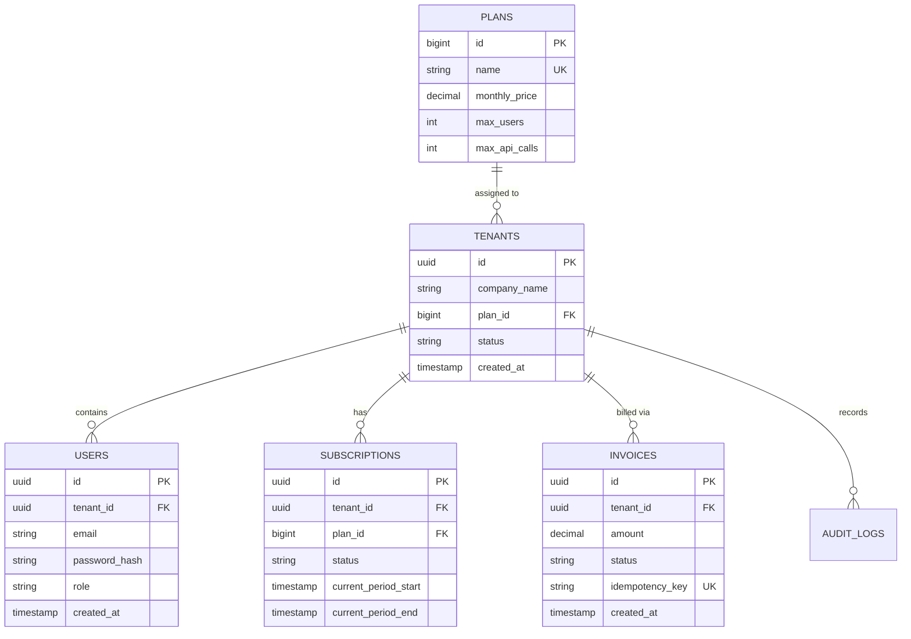

# System Architecture & Invariants — B2B SaaS Billing Engine

---

## 1. High-Level System Architecture

```
                       [ Client / Frontend / API Consumer ]
                                        │
                                        │ (HTTP + Bearer JWT + X-Idempotency-Key)
                                        ▼
             ┌─────────────────────────────────────────────────────────┐
             │               Spring Boot 3 Web Application             │
             │                                                         │
             │  ┌───────────────────────────────────────────────────┐  │
             │  │            Security & Filter Pipeline             │  │
             │  │  1. CorrelationIdFilter (Tracing)                 │  │
             │  │  2. JwtAuthenticationFilter (Extract Tenant ID)   │  │
             │  │  3. TenantContextFilter (Set ThreadLocal context) │  │
             │  │  4. IdempotencyFilter (Prevent duplicate charges) │  │
             │  └─────────────────────────┬─────────────────────────┘  │
             │                            │                            │
             │                            ▼                            │
             │  ┌───────────────────────────────────────────────────┐  │
             │  │                REST Controllers                   │  │
             │  │  - AuthController       - TenantController        │  │
             │  │  - PlanController       - SubscriptionController  │  │
             │  │  - InvoiceController    - UserController          │  │
             │  └─────────────────────────┬─────────────────────────┘  │
             │                            │                            │
             │                            ▼                            │
             │  ┌───────────────────────────────────────────────────┐  │
             │  │                 Service Layer                     │  │
             │  │  - Business logic, quota verification             │  │
             │  │  - Database transactions (@Transactional)         │  │
             │  └─────────────────────────┬─────────────────────────┘  │
             │                            │                            │
             │                            ▼                            │
             │  ┌───────────────────────────────────────────────────┐  │
             │  │           Repository Layer (Spring Data JPA)      │  │
             │  │  - Hibernate Tenant Discriminator Filter          │  │
             │  │  - Row-Level Locking (SELECT ... FOR UPDATE)      │  │
             │  └─────────────────────────┬─────────────────────────┘  │
             └────────────────────────────┼────────────────────────────┘
                                          │
                         ┌────────────────┴────────────────┐
                         ▼                                 ▼
             [ PostgreSQL 16 (Relational) ]     [ Redis 7 (Cache/Locks) ]
             - Flyway Versioned Migrations      - Distributed Locks
             - Scoped Indexes (tenant_id)       - Rate Limiting
```

---

## 2. Multi-Tenancy Strategy: Discriminator Column Pattern

For high-density B2B SaaS, the **Discriminator Column (Shared Database, Shared Schema)** pattern provides optimal resource efficiency, simpler migrations, and robust pooling.

### The Mechanics:
1. Every multi-tenant entity table (`users`, `invoices`, `subscriptions`, `audit_logs`) includes a `tenant_id UUID NOT NULL` column.
2. In Java, incoming requests pass through `JwtAuthenticationFilter`:
   - It decodes the JWT claims: `sub` (email), `tenantId` (UUID), `role` (String).
   - It populates `TenantContext`:
     ```java
     public final class TenantContext {
         private static final ThreadLocal<UUID> CURRENT_TENANT = new ThreadLocal<>();
         public static void setTenantId(UUID tenantId) { CURRENT_TENANT.set(tenantId); }
         public static UUID getTenantId() { return CURRENT_TENANT.get(); }
         public static void clear() { CURRENT_TENANT.remove(); }
     }
     ```
3. In Spring Data JPA Repositories:
   - All queries filter by `tenant_id` automatically or via explicit method contract:
     ```java
     Optional<User> findByIdAndTenantId(UUID id, UUID tenantId);
     List<Invoice> findAllByTenantId(UUID tenantId, Pageable pageable);
     ```

---

## 3. Relational Storage Model (PostgreSQL)



---

## 4. Architectural Invariants (Non-Negotiable Rules)

1. **Zero Cross-Tenant Leakage:** An authenticated user from Tenant $A$ must never receive data from Tenant $B$. Cross-tenant queries must return `404 Not Found` (to avoid leaking resource existence) or `403 Forbidden`.
2. **Context Cleanup:** The `TenantContextFilter` must clear `ThreadLocal` in a `finally` block on every single request. Never allow thread reuse to leak tenant IDs across requests in connection pools.
3. **Integer / BigDecimal Currency:** All money calculations must use `BigDecimal` with explicit scale (`2`) and rounding mode (`RoundingMode.HALF_UP`). Floating-point arithmetic (`float`, `double`) is strictly forbidden.
4. **Idempotency Enforcement:** All payment charges and invoice generation endpoints require an `X-Idempotency-Key` header. Duplicate requests within a 24-hour window must return the identical cached response without re-executing logic.
5. **No Open-Ended Database Queries:** All list endpoints must require pagination (`Pageable` with maximum limit of 50 items).
6. **Stateless Authentication:** Server sessions are forbidden. All authentication is strictly stateless via signed JWTs verified cryptographically on each request.
